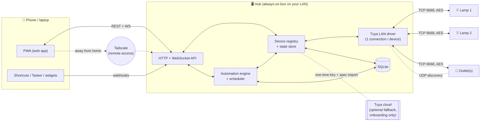

# Design: architecture

> Status: proposal v0.1. Builds on [research/tuya-platform.md](../research/tuya-platform.md).
> The automation engine has its own spec: [automations.md](automations.md).

## 1. Goals

1. **Replace the BARDI app** for day-to-day control of 2 RGBWW lamps now, plus smart outlets later.
2. **Much better scenes and automations** than Tuya's Tap-to-Run/Automation: conditions, if/else, delays, modes, sun times, device-to-device triggers, run history.
3. **Local-first:** works when the internet is down, with responses well under a second.
4. **Cheap and low-maintenance:** runs on a small always-on box, no subscriptions, no Tuya developer trial to keep renewing.
5. **Expandable:** new device types are mostly a profile file, not new code.

Non-goals for v1: cameras, Zigbee/BLE devices, voice assistants, multi-user households with permissions, publishing to app stores.

## 2. Key decision: phone app + always-on hub

A phone-only app **can't** do this job well:
- Automations have to run when your phone is asleep, away, or out of battery. Android and iOS both kill background work, which is exactly why Tuya runs its automations in the cloud.
- **A Tuya device accepts only one LAN connection at a time.** Two phones (or a phone and a tablet) would keep knocking each other off.

So the design is a small **hub** on your home network that owns all device connections and runs the automations, and a **PWA** (installable web app) as the remote control.



### Where the hub runs

Anything that's always on and on the same network as the devices:

| Option | Notes |
|---|---|
| Raspberry Pi (Zero 2 W / 4 / 5) | the classic choice, ~2–5 W |
| Old Android TV box flashed with Armbian (e.g. ex-IndiHome STBs) | very cheap in Indonesia, good enough for this |
| Old laptop / mini PC / NAS with Docker | fine if it's already always on |
| Old Android phone + Termux | possible but Android kills background apps, so I wouldn't rely on it |

The hub needs a few hundred MB of RAM and almost no CPU. It ships as a Docker image and as a plain `pip install` + systemd unit.

## 3. Tech stack

| Layer | Choice | Why |
|---|---|---|
| Hub language | **Python 3.12** | [TinyTuya](https://github.com/jasonacox/tinytuya) is the most complete LAN implementation (protocol 3.1–3.5, actively maintained), and Tuya's key-onboarding SDK is Python too |
| Device I/O | `tinytuya` (wrapped, see §5) | handles crypto, handshakes, framing, discovery |
| Web/API | FastAPI + uvicorn | async, WebSockets, typed models, auto OpenAPI docs |
| Models / validation | Pydantic v2 | the same models validate API input, the automation YAML, and the DB JSON |
| Storage | SQLite (WAL mode) | single file, zero admin, easy backups |
| Sun times | `astral` | local sunrise/sunset/dusk from lat/long, no weather API |
| Client | **PWA: TypeScript + Svelte + Vite** | one codebase for Android, iOS and desktop, "Add to Home Screen", served by the hub itself. Can be wrapped with Capacitor later if you want native widgets |
| Remote access | **Tailscale** (free personal plan) | private VPN, no port forwarding, no exposing the hub to the internet |
| Push notifications (optional) | ntfy (self-hosted or ntfy.sh) | dead simple, has Android/iOS apps |

Repo layout once code starts:

```
hub/                    Python package: the hub service
  bardisucks/
    api/                FastAPI routers + WebSocket hub
    devices/
      registry.py       device registry, desired vs. reported state
      profiles/*.yaml   capability ↔ DP mappings (lamp, plug, …)
      drivers/
        tuya_local.py   LAN driver (TinyTuya wrapper)
        tuya_cloud.py   optional fallback (later)
    engine/             automation engine: triggers, conditions, actions, scheduler
    store/              SQLite schema + migrations
  tests/
web/                    PWA (Svelte + Vite)
tools/
  import_keys.py        turn tuya-local-key / tinytuya output into hub devices
docs/
```

## 4. Domain model

### 4.1 Device

```yaml
id: lamp-living                 # our id (slug)
name: Living room lamp
room: living
tuya:
  device_id: bf1234567890abcdef  # Tuya's id
  ip: 192.168.1.50               # last known; auto-updated from discovery
  version: "3.3"                 # protocol version
  product_id: keyxxxx            # used to pick a profile
  category: dj                   # dj = light, cz = plug
  # local_key is NOT stored here, it lives in the secrets store (§8)
profile: tuya-light-rgbcw-v2     # see 4.2
options:
  restore_on_reconnect: false    # re-apply last desired state after a power cut
```

### 4.2 Capabilities and profiles

The rest of the app never sees raw DPs. A **profile** maps normalized **capabilities** to DPs, including scaling. That way scenes and automations say `brightness: 40` instead of `{"22": 400}`.

```yaml
# devices/profiles/tuya-light-rgbcw-v2.yaml
id: tuya-light-rgbcw-v2
match: { category: dj, has_dps: [20, 21, 22, 23, 24] }
capabilities:
  power:      { dp: 20, type: bool }
  mode:       { dp: 21, type: enum, map: { white: white, colour: color, scene: scene, music: music } }
  brightness: { type: percent, via: mode_dependent,           # see research §2.1 gotcha
                white: { dp: 22, range: [10, 1000] },
                color: { dp: 24, field: v, range: [10, 1000] } }
  color_temp: { dp: 23, type: percent, range: [0, 1000], kelvin_hint: [2700, 6500] }
  color:      { dp: 24, type: hsv, codec: tuya_hsv12 }        # HHHHSSSSVVVV
  effect:     { dp: 25, type: tuya_scene }
  timer:      { dp: 26, type: duration, unit: s, max: 86400 }
```

```yaml
# devices/profiles/tuya-plug-metering.yaml
id: tuya-plug-metering
match: { category: cz, has_dps: [1, 19] }
capabilities:
  power:          { dp: 1, type: bool }
  timer:          { dp: 9, type: duration, unit: s }
  energy_kwh:     { dp: 17, type: number, scale: 3, read_only: true }  # verify scale per device
  current_ma:     { dp: 18, type: number, read_only: true }
  power_w:        { dp: 19, type: number, scale: 1, read_only: true }
  voltage_v:      { dp: 20, type: number, scale: 1, read_only: true }
  power_on_state: { dp: 38, type: enum, values: [off, on, memory] }
  indicator:      { dp: 40, type: enum, values: [none, on, relay, pos] }
  child_lock:     { dp: 41, type: bool }
polling: { refresh_dps: [18, 19, 20], every: 10s }   # some plugs only push energy on request
```

During onboarding, the importer reads each device's cloud spec (codes, ranges, scales) and either matches an existing profile or **generates one**. Adding a new outlet model should be a profile file, not new code. Later on we can borrow from [tuya-local's device library](https://github.com/make-all/tuya-local), which has 1000+ device configs.

### 4.3 State: desired vs. reported

For each device the registry keeps:
- **reported**: last state the device pushed (source of truth for the UI).
- **desired**: what we last asked for, with a timestamp.
- **online**, **last_seen**, **rssi** (if reported).

A command updates *desired*, the UI shows it optimistically, and the driver sends it. When the device's push confirms it, the UI settles. If no confirmation arrives within ~3 s, the driver retries once and then raises a `command_failed` event, which shows up in the UI and can trigger an automation.

### 4.4 Scenes, modes, automations

- **Scene:** named set of target states (`lamp-living: {power: on, brightness: 30, color_temp: 10}`), optional per-device transition. Can be captured from current state.
- **Mode:** a global variable such as `home` / `away` / `sleep` / `movie`. Automations read it in conditions and set it in actions. User-defined.
- **Automation:** triggers → conditions → actions. Full spec in [automations.md](automations.md).

## 5. Device driver layer

```
DeviceConnection (one per device, own thread)
 ├─ connect → handshake (3.4/3.5) → set_socketPersistent(True)
 ├─ loop:
 │    receive() with 1 s timeout
 │      ├─ status push  → normalize via profile → registry.on_reported(...)
 │      └─ nothing      → heartbeat every 12 s, full status() every 60 s
 │    drain command queue (coalesced, rate-limited)
 ├─ on error → mark offline after 3 failures, reconnect with backoff 1 s → 60 s
 └─ on IP change (from discovery listener) → reconnect to new IP
DiscoveryListener (one thread)
 └─ UDP 6666/6667 listen + UDP 7000 probe (v3.5) → map device_id → ip/version
```

Rules:
- **One owner per device.** Nothing else in the hub opens a socket to a device. The API, engine and UI all go through the registry.
- **Command coalescing:** if three brightness changes queue up while a slider moves, only the last one gets sent. Different DPs are merged into one `set_multiple_values` frame.
- **Rate limit:** ≥ 150 ms between frames to the same device, and energy refresh no faster than every 10 s.
- **Threads ↔ asyncio:** TinyTuya is blocking-socket based. Each `DeviceConnection` runs in a thread and hands events to the asyncio loop with `loop.call_soon_threadsafe`. With fewer than 30 devices that's simpler and more robust than rewriting the protocol in asyncio. (TinyTuya's experimental `Monitor` class is an alternative to evaluate.)
- **Driver interface** is small (`connect`, `send(dps)`, `refresh()`, events out), so an `openbeken_mqtt` or `tuya_cloud` driver can drop in later.

### Software fades

Tuya bulbs have no "go to X over N seconds" command over LAN. `transition: 10m` is done by the hub: interpolate and send a step every ~1–2 s (rounded to the bulb's 10–1000 steps). If anything else changes that device mid-fade, the fade gets cancelled. For short, decorative effects, use the bulb's own effects via DP 25 instead.

## 6. API

All endpoints need `Authorization: Bearer <client token>`, except webhooks, which use their own per-hook secret.

| Method | Path | Purpose |
|---|---|---|
| GET | `/api/devices` | list with capabilities + current state |
| PATCH | `/api/devices/{id}/state` | `{"power": true, "brightness": 40, "transition": "2s"}` |
| POST | `/api/devices/{id}/toggle` | convenience |
| PUT | `/api/devices/{id}` | rename, room, options |
| GET/POST/PUT/DELETE | `/api/scenes[/{id}]` | scene CRUD |
| POST | `/api/scenes/{id}/activate` | run a scene |
| POST | `/api/scenes/capture` | create a scene from current states |
| GET/POST/PUT/DELETE | `/api/automations[/{id}]` | CRUD (JSON or YAML body) |
| POST | `/api/automations/{id}/run` | manual run (skip triggers, optionally skip conditions) |
| PATCH | `/api/automations/{id}` | `{"enabled": false}` |
| GET | `/api/automations/{id}/traces` | last N runs with step-by-step trace |
| GET/PUT | `/api/modes` | current mode + list |
| GET | `/api/history?device=&capability=&from=&to=` | e.g. plug watts over time |
| POST | `/api/hooks/{hook_id}` | webhook trigger (Shortcuts, Tasker, NFC tags, …) |
| WS | `/api/ws` | push events: `state`, `online`, `automation_run`, `mode`, `notification` |

## 7. App (PWA) screens

1. **Home:** room sections with device tiles. Tap toggles, long-press opens details. Favourite scene chips and the current **mode** sit at the top. Live updates come over WebSocket.
2. **Lamp:** big brightness slider, white ↔ colour tabs, colour-temperature slider, colour wheel, presets, built-in effects, sleep timer (uses the on-device countdown so it works even if the hub dies), "save as scene".
3. **Outlet:** on/off, live watts, today/this month kWh, 24 h chart, countdown, power-on behaviour, child lock.
4. **Scenes:** grid of scenes, one tap to run. The editor picks devices, sets states, and has "capture current" and a per-device transition.
5. **Automations:** list with an enable switch, last-run time and result (✓ / skipped by condition / ✗ error). The editor has **When / Only if / Then** blocks with nested `if`, `delay` and `wait`, plus a **YAML** tab for power-user edits and a **Test run** button. A **trace viewer** shows which trigger fired, how each condition evaluated, and each action's result.
6. **Settings:** location (for sun times), rooms, devices (import, rename, re-key), modes, webhooks (copy URL), connected clients (revoke), backup/restore (export everything as one YAML file).

The design language is a dark-mode-first, thumb-reachable layout. Everything has to be usable with one hand from the home-screen icon in under 2 taps.

## 8. Security

- **Local keys** are equivalent to full device control. They're stored in `data/secrets.json` (mode 0600) on the hub, are **never sent to clients**, and are excluded from git (see `.gitignore`). Backups that include keys are encrypted with a passphrase.
- **The hub is never exposed to the internet.** Remote access goes through Tailscale. No port forwarding.
- **Client auth:** first launch shows a 6-digit pairing code in the hub's log or terminal. The PWA exchanges it for a long-lived token you can revoke per device in Settings.
- **Webhooks** get their own random 128-bit secrets, each bound to a single automation, so a leaked Shortcut URL can only fire that one thing.
- **Optional hardening (later):** put IoT devices on a separate Wi-Fi/VLAN and block their internet at the router once you've confirmed local control works without the cloud. Note that this also kills Smart Life remote control and Tuya OTA updates. Losing OTA is arguably a plus, since a firmware update can't change the protocol under you.

## 9. Reliability

| Situation | Behaviour |
|---|---|
| Internet down | everything keeps working (LAN only) |
| Hub restarts | reconnects to devices, recomputes schedules. Optional **catch-up**: a time/sun trigger missed less than *N* minutes ago still fires (per automation) |
| Power cut | devices come back to their `power_on_state`. When a device comes back online, an automation can re-apply the scene or restore the last desired state |
| Device DHCP IP changes | discovery listener notices and the driver reconnects (still set a DHCP reservation in the router) |
| Hub down entirely | lamps and plugs still work by hand and by the Smart Life app (via cloud). On-device countdown timers still fire |
| Someone re-pairs a device in Smart Life | the key changes, so the device shows "auth failed" with a **Re-import key** button |

## 10. Roadmap

| Phase | Deliverable | Done when |
|---|---|---|
| **0. Onboarding** | Devices moved to Smart Life, keys pulled, local control verified with a script ([guide](../guides/phase-0-onboarding.md)) | `python tools/probe.py` toggles both lamps |
| **1. Hub core** | registry, TinyTuya driver with persistent connections, profiles for the lamps, REST + WS API, key importer | lamp state changes show up in < 500 ms, both lamps controllable via API |
| **2. PWA v1** | Home + Lamp screens, pairing, installable | daily use replaces the BARDI app |
| **3. Scenes** | scene CRUD, capture, activate, software fades | "Movie", "Warm evening", "All off" work |
| **4. Automations** | engine with time/sun/device/manual/webhook triggers, conditions, if/delay/wait actions, modes, traces | the automations you wanted in Bardi but couldn't build all run |
| **5. Outlets** | plug profile, energy history + charts, power-on-state settings | outlet watts chart, "turn off when idle" automation |
| **6. Remote + phone integrations** | Tailscale guide, webhooks for Shortcuts/Tasker, ntfy notifications | toggle lamps from a home-screen shortcut while away |
| **7. Nice-to-haves** | cloud fallback driver, OpenBeken/MQTT driver, Capacitor wrapper with Android quick-settings tile, presence detection | |

## 11. Alternatives considered

| Option | Verdict |
|---|---|
| **Home Assistant + Tuya Local/LocalTuya** | Honestly the fastest way to get good automations today. It already does all of this, but it's heavy for 2–6 devices and the UI isn't tailored. This design borrows its best ideas (run modes, traces, YAML). If you mostly want it working this week and the custom app is secondary, install HA. |
| Phone-only app talking LAN directly | Automations can't run reliably in the background, and there's the one-connection-per-device conflict (§2) |
| Tuya Cloud OpenAPI as the main path | internet dependency, latency, quotas, trial renewal |
| Tuya Smart Life App SDK | commercial licence, built for companies shipping branded apps |
| Flash all devices to OpenBeken first | best long-term privacy, but risky and chip-dependent. Kept as a later driver, not a prerequisite |

## 12. Open questions for you

1. **Hub hardware:** what always-on device do you have (Pi, old laptop, STB, PC)?
2. **Phone:** Android or iOS? (This decides quick-settings tiles vs. Shortcuts as the "fast button".)
3. **Exact models:** which Bardi lamps (9 W / 12 W RGBWW?) and which outlets are you looking at? Energy monitoring is worth paying a bit extra for.
4. **The automations Bardi wouldn't let you build:** list 3–5. They become the acceptance tests for phase 4.
5. **Languages:** OK with Python (hub) + TypeScript/Svelte (app)?

### Buying tips for the outlets

- Any Tuya-based plug (Bardi or otherwise) works with this design. Pick **energy-monitoring** models (they have DPs 18–20).
- **Pair new outlets straight into Smart Life**, not the BARDI app, so you don't have to move them later.
- If you might flash OpenBeken someday, check the model on the cloudcutter device list **before** first pairing, since pairing can trigger an OTA update that closes the exploit.
