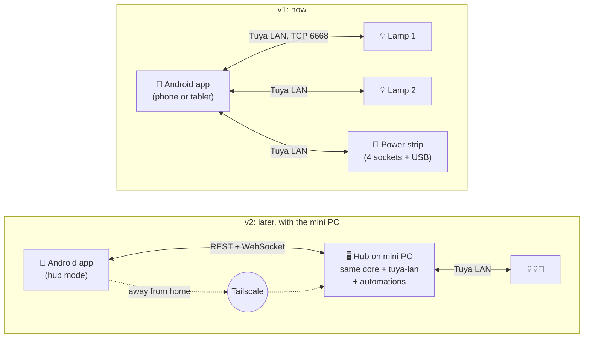

# Design: architecture

> Status: proposal **v0.4**. **Android only (phones + tablets), no server yet.** Focus is customization, groups and one-tap scenes ([groups-and-scenes.md](groups-and-scenes.md)). Your sister's tablet, Huawei notes and why iOS is parked: [household-and-platforms.md](household-and-platforms.md).
> Automations are parked until the mini-PC hub exists ([automations.md](automations.md)).
> Background: [research/tuya-platform.md](../research/tuya-platform.md).

## 1. Goals

1. **Replace the BARDI app** for 2× BARDI 12 W RGB+WW bulbs now, plus a 4-socket smart power strip later, on **your Android phone**. Your sister runs the same app on her **Huawei tablet** for her own lamps.
2. **Groups that actually work:** colour, brightness, white temperature and effects on a whole group, not just power and mode.
3. **One-tap scenes with real options:** any field on any lamp/socket/group, partial changes, toggle/restore, cycle, on-device off-timers.
4. **Customization:** names, icons, rooms, layout, palettes, themes, plus Quick Settings tiles, home-screen widgets and launcher shortcuts. Tablet layout too.
5. **Local:** talks to devices over home Wi-Fi, works when the internet is down, responds well under a second.
6. **Ready for the hub later:** the device and scene logic is written once and reused by the future mini-PC server.
7. **No Google Play services dependency**, so it runs on Huawei devices (and any Android) as a plain APK.

Non-goals for v1: automations/schedules (→ hub), remote control away from home (→ hub + Tailscale), iOS ([parked](household-and-platforms.md#4-ios-parked)), cameras, Zigbee/BLE.

## 2. Key decisions

### 2.1 v1 = the phone talks directly to the devices

Without automations, nothing has to run 24/7, so we don't need a server yet. The app on each phone/tablet opens the encrypted LAN connection to each of *its* lamps/strip itself.

The one Tuya constraint to respect is **one LAN connection per device**. The app holds connections only while it's on screen and releases them shortly after you leave. Widgets and tiles connect, send and disconnect (§6).

### 2.2 Native Android (Kotlin), not a web app

- **Browsers can't open raw TCP/UDP sockets**, so a web app/PWA can't talk to Tuya devices without a server in the middle. With no server in v1, it has to be native.
- **Quick Settings tiles, home-screen widgets and launcher shortcuts** are a big part of "one tap", and they're native Android features.
- The protocol (`tuya-lan`) and domain logic (`core`) are **plain Kotlin with no Android APIs**. The future hub on the mini PC reuses them as-is. They also keep iOS possible later (they'd move to Kotlin Multiplatform), but nothing is built for iOS now.

### 2.3 v2 (later) = mini-PC hub

When the mini PC exists, it takes over device connections and runs automations. The app gains a **hub mode** and talks to the hub instead of the devices.



## 3. Tech stack

| Layer | Choice | Why |
|---|---|---|
| Language | **Kotlin** | Android standard. `core` + `tuya-lan` are plain Kotlin/JVM, reused by the hub later |
| UI | **Jetpack Compose + Material 3** | modern, easy custom colour wheel/sliders, adaptive layouts for phone **and tablet** |
| One-tap | `TileService` (6 slots), **Jetpack Glance** widgets, launcher shortcuts, deep links | native Android |
| Async | kotlinx.coroutines | parallel group fan-out, per-device actors |
| Storage | **Room** (SQLite) + DataStore | channels, groups, scenes, palettes, settings |
| Secrets | `local_key`s AES-GCM-encrypted with an **Android Keystore** key | keys never leave the device in plaintext |
| Serialization | kotlinx.serialization | profiles, import/export, backup |
| Crypto | `javax.crypto` (AES-ECB, AES-GCM, HMAC-SHA256) + `java.util.zip.CRC32` | everything the Tuya protocol needs, no native libs |
| Build & release | Gradle, GitHub Actions on **free Linux runners** → signed APK | no Mac, no store, no fees |
| Reference / test oracle | **TinyTuya** (Python, on a laptop) | used to verify our Kotlin protocol port against real devices |

Min SDK 26 (Android 8), target latest. Permissions: `INTERNET`, `ACCESS_WIFI_STATE`, `CHANGE_WIFI_MULTICAST_STATE` (to hear discovery broadcasts), plus the local-network permission on Android versions that require it.

**No Google Play services anywhere** (no Firebase, FCM, Play Integrity, Maps or ML Kit). Huawei devices don't have them, and we don't need them: everything is local. Material You wallpaper colours are used where the OS supports them, with a chosen accent colour otherwise (e.g. on HarmonyOS).

### Repo layout (once code starts)

```
tuya-lan/        plain Kotlin/JVM: Tuya LAN protocol 3.1–3.5, discovery, DeviceConnection
core/            plain Kotlin: channels, profiles, groups, scenes, effects codec, colour math, import/export
app/             Android app: Compose UI (phone + tablet layouts), Room, tiles, widgets, shortcuts
cli/             JVM command-line tool: test tuya-lan against real devices from a laptop
hub/  (later)    Ktor server on the mini PC, reusing core + tuya-lan; automations live here
docs/
```

## 4. Domain model

Full details in [groups-and-scenes.md §2](groups-and-scenes.md#2-model). In short:

- **Device:** Tuya id, IP, protocol version, product id, category, encrypted `local_key`, profile.
- **Channel:** a controllable endpoint on a device (lamp = 1 light channel, strip = 4 sockets + USB). Has name, icon, room, flags.
- **Room / Group / Scene / Palette / Effect:** all point at channels.

### 4.1 Profiles: capabilities ↔ DPs

The UI and scene engine never touch raw DP numbers. A profile maps capabilities to DPs, and ships as JSON inside `core`:

```yaml
id: tuya-light-rgbcw-v2           # BARDI 12 W RGB+WW (verify in phase 0)
match: { category: dj, has_dps: [20, 21, 22, 23, 24] }
channels:
  - kind: light
    power:      { dp: 20 }
    mode:       { dp: 21, map: { white: white, colour: color, scene: effect, music: music } }
    brightness: { white: { dp: 22, range: [10, 1000] }, color: { dp: 24, field: v, range: [10, 1000] } }
    white_temp: { dp: 23, range: [0, 1000], kelvin_hint: [2700, 6500] }
    color:      { dp: 24, codec: hsv12 }            # HHHHSSSSVVVV
    effect:     { dp: 25, codec: tuya_scene }       # see research §2.3
    live:       { dp: 28, codec: control21 }        # drag preview
    countdown:  { dp: 26, unit: s, max: 86399 }
```

```yaml
id: tuya-strip-4-usb
match: { category: pc, has_dps: [1, 2, 3, 4, 5] }
channels:
  - { kind: socket, key: "1",   power: { dp: 1 }, countdown: { dp: 9 } }
  - { kind: socket, key: "2",   power: { dp: 2 }, countdown: { dp: 10 } }
  - { kind: socket, key: "3",   power: { dp: 3 }, countdown: { dp: 11 } }
  - { kind: socket, key: "4",   power: { dp: 4 }, countdown: { dp: 12 } }
  - { kind: socket, key: "usb", power: { dp: 5 }, countdown: { dp: 13 } }
device_settings:
  power_on_state: { dp: 38, values: [on, off, memory] }
  indicator:      { dp: 40, values: [relay, pos, none] }
  child_lock:     { dp: 41 }
energy:   # only on energy-monitoring strips
  { kwh: 17, ma: 18, w: { dp: 19, scale: 1 }, v: { dp: 20, scale: 1 } }
```

When keys are imported, the importer reads the DP spec that the key tool exported, picks a matching profile, or **generates one** and lets you fix it in a "Device details / DPs" screen.

### 4.2 State

For each channel the app keeps the **reported** state (what the device last pushed) and **pending** commands. A command updates the UI immediately (optimistic). The device's status push confirms it. With no confirmation in ~3 s, the app retries once and then shows the tile as "didn't respond".

## 5. Tuya LAN layer (`tuya-lan` module)

A Kotlin port of what TinyTuya does, built in this order:
1. **Frame codec:** `0x55AA` frames (3.1–3.4) and `0x6699` frames (3.5). Sequence numbers, CRC32 / HMAC-SHA256 / GCM tags.
2. **Crypto + session:** AES-128-ECB payloads, and for 3.4/3.5 the 3-message session-key negotiation (cmd `0x03`/`0x04`/`0x05`).
3. **Commands:** `CONTROL` (`0x07`) / `CONTROL_NEW` (`0x0d`), `DP_QUERY` (`0x0a`) / `DP_QUERY_NEW` (`0x10`), `STATUS` push (`0x08`), `HEART_BEAT` (`0x09`), `UPDATEDPS` (`0x12`).
4. **Discovery:** listen on UDP 6666/6667 and probe UDP 7000 (3.5) to learn IP and version. On a shared Wi-Fi this also hears *other people's* Tuya devices, so the app only lists devices it has a key for. The rest show up under "Other devices on this network", hidden by default.

We only build the protocol versions the Bardi devices actually report (phase 0 scan) first. The rest come later.

**Testing:**
- **Golden tests:** TinyTuya on a laptop produces frames for a known key/payload/nonce. Our encoder has to produce identical bytes, and our decoder has to parse TinyTuya's.
- **Live tests:** the `cli` tool toggles and reads the real lamps from a laptop before any Android UI exists.

## 6. Connections on the phone

```
ConnectionManager (singleton, app process)
 ├─ DeviceActor per device (coroutine + command channel)
 │    connect → handshake → persistent socket
 │    receive loop: status pushes → normalize via profile → StateStore → UI/widgets
 │    heartbeat every ~12 s
 │    commands: coalesce (last value per DP wins), merge into one multi-DP frame,
 │              ≥150 ms between frames, live-preview (DP 28) throttled to ~5/s
 ├─ Discovery (UDP + MulticastLock) while app is in foreground
 └─ Lifecycle:
      app visible           → connect all devices (warm, so groups fire in sync)
      app hidden > 30 s     → close all (frees the device's single LAN slot, saves battery)
      tile/widget/shortcut  → connect only the needed devices, send, read back, close
      shared device (opt.)  → "polite mode": also release it ~20 s after the last touch
```

- **Group fan-out:** one coroutine per member device, all sent at once (`awaitAll`). With warm connections, members change within ~100 ms of each other.
- **Mode-safe commands:** setting colour on a lamp in white mode sends `switch_led + work_mode=colour + colour_data` in **one frame**, which is exactly what BARDI groups don't do.
- **Not home / unreachable:** if the devices don't answer, tiles and widgets show "Not on home Wi-Fi" and offer to open Smart Life (cloud) instead.

## 7. Getting keys onto the phone

The one-time key fetch happens on a laptop ([phase 0 guide](../guides/phase-0-onboarding.md)). Then:
- **Import file:** the app accepts `tuya-local-key` output or TinyTuya's `devices.json` (+ `tuya-raw.json` for DP specs). Send it to the phone/tablet (Quick Share / USB / Drive / WhatsApp to yourself), then go to **Settings → Import devices**. Pick which devices to import, so your sister's tablet only takes her lamps. The app encrypts the keys and you delete the file.
- **Share devices (optional, later):** export selected devices from one app to another if you ever want to control each other's lamps. See [household-and-platforms.md §1](household-and-platforms.md#1-your-sisters-setup).
- **Manual add:** id + key + IP + version form (IP/version can be auto-filled from discovery).
- **Later:** an in-app QR login (same flow as `tuya-local-key`), needing a second screen to show the QR. Not needed for v1.

## 8. Security

- `local_key`s are encrypted with a non-exportable Android Keystore key, excluded from Android auto-backup, never logged, and shown only after a fingerprint/PIN check.
- The release APK is signed with **your own signing key**. Keep it backed up outside the repo (`*.jks`/`*.keystore` are git-ignored). Losing it means updates can't install over the old app.
- **Backup/export** is one file. Keys are included only if you set a passphrase. The same file imports into the hub later.
- The repo `.gitignore` blocks key files (`devices.json`, `tinytuya.json`, `tuya-raw.json`, `snapshot.json`, `/secrets/`).
- **Optional later:** put the IoT devices on their own Wi-Fi/VLAN and block their internet access once local control is proven.

## 9. Reliability

| Situation | Behaviour |
|---|---|
| Internet down | everything works (LAN only) |
| Phone off / away | lamps and strip still work by hand and via Smart Life (cloud). On-device countdowns still fire |
| Smart Life open on another phone at the same time | that phone uses cloud control, which works fine. If it grabbed the LAN slot, our app retries |
| You + sister on the same Wi-Fi, different lamps | no conflict: each app only connects to its own lamps |
| Two apps controlling the *same* lamp (only if you share devices later) | polite mode releases idle connections. Tapping at the same instant means one retries. The hub removes this entirely |
| Device IP changes | discovery finds it again. Still set DHCP reservations |
| Device re-paired in Smart Life | key changed, so the app shows **Re-import key** |
| Power cut | the strip follows its power-on setting (DP 38: on/off/memory), and bulbs follow their own power-on behaviour |

## 10. Roadmap

| Phase | Deliverable | Done when |
|---|---|---|
| **0. Onboarding** | lamps moved to Smart Life, keys pulled, local control verified with TinyTuya, DP dumps + checks from [research §7](../research/tuya-platform.md#7-open-questions-to-check-on-your-devices) | a Python probe toggles both lamps |
| **1. `tuya-lan` + CLI** | Kotlin protocol for the version(s) your lamps use, golden tests, CLI | `cli toggle lamp-1` works from a laptop |
| **2. App skeleton + lamp control** | import keys, device list, full lamp screen with live colour preview | daily lamp control without BARDI |
| **3. Rooms & groups** | union capabilities, relative brightness, palette colour, in-sync fan-out | colour + brightness on "All lamps" works |
| **4. Power strip** | per-socket channels, all on/off, countdowns, power-on state, child lock, LED | each socket named and grouped |
| **5. One-tap scenes** | normal/toggle/cycle, partial states, capture current, on-device off-timers | your 3–5 favourite looks are one tap |
| **6. Android surfaces** | 6 QS tile slots, Glance widgets, launcher shortcuts, deep links | lamps controllable without opening the app |
| **7. Effects & polish** | built-in effects, custom effect editor, palette-from-photo, themes, backup, Indonesian strings | |
| **Tablet & sister** (with phase 2–3) | adaptive two-pane layout, dashboard mode, selective import, test on her Huawei tablet ([checklist](household-and-platforms.md#2-huawei-tablet-checklist)) | your sister controls her lamps from her tablet |
| **Later: hub** | mini PC + `hub/` (Ktor) + hub mode in app, automations ([parked spec](automations.md)), Tailscale remote. One hub can serve both your lamps and your sister's (separate "homes") | |

## 11. Planning the mini PC (later, short version)

The hub is tiny: a few hundred MB RAM, almost no CPU.
- **Hardware:** any low-power x86 mini PC (Intel N100-class) or a Raspberry Pi 4/5. Something around 6–10 W idle is ideal since it runs 24/7.
- **Network:** wired Ethernet to the router, on the **same subnet** as the lamps/strip (UDP discovery doesn't cross subnets).
- **Software:** Debian/Ubuntu Server + Docker + Tailscale. The hub is one container. The same box can host other stuff (Pi-hole, media, backups).
- When you get there, we'll write a separate hub design doc and un-park the automation spec.

## 12. Alternatives considered

| Option | Verdict |
|---|---|
| PWA / web app | can't open raw sockets, so it needs a server. Fits v2 as an extra client, not v1 |
| Flutter + Dart `tinytuya` port | there's a young Dart port that claims 3.1–3.5 support. Viable, but QS tiles/widgets still need native code, and the hub couldn't share the code as easily. Kotlin wins on both |
| Kotlin Multiplatform for iOS too | possible (Compose Multiplatform is stable on iOS), but iOS needs a Mac and $99/yr to install without 7-day expiry. Parked. `core`/`tuya-lan` stay platform-neutral so it's not ruled out |
| Embed Python TinyTuya in Android (Chaquopy) | works, but adds ~20 MB+ and a second runtime. A Kotlin port is cleaner and reusable on the hub |
| Tuya Smart Life App SDK | commercial licence, cloud-based |
| Home Assistant + Tuya Local | great for automations, but you said customization/UI is the main pain, and HA's UI isn't tailored for this. Still a fine choice for the mini PC era if you'd rather not build the hub |

## 13. Still open

- **Your sister's tablet OS:** HarmonyOS 2–4 / EMUI runs our APK. HarmonyOS 5/6 ("NEXT") does not ([checklist](household-and-platforms.md#2-huawei-tablet-checklist)).

- **Power strip model:** pick one that's Tuya/Smart Life-compatible with **individually switchable** sockets (+ switchable USB). Energy monitoring is a bonus. Pair it straight into Smart Life, not BARDI.
- **Protocol version** of the 12 W bulbs (phase 0 scan) decides which part of `tuya-lan` gets built first.
- The phase 0 checks in [research §7](../research/tuya-platform.md#7-open-questions-to-check-on-your-devices) (live preview DP, countdown behaviour, effect strings, sleep/wake DPs).
